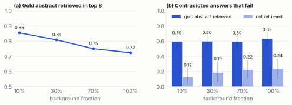
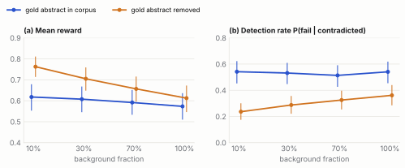
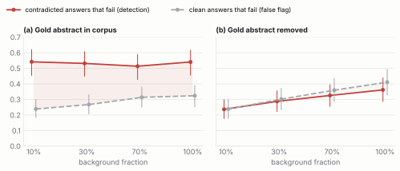
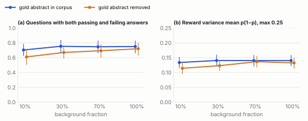
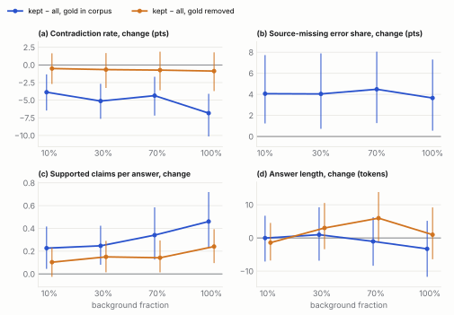
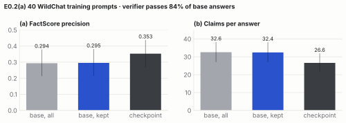
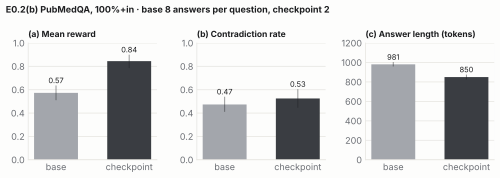
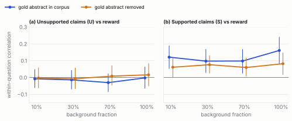

## Motivation

Binary RAR (Chen et al.) introduces a reward function to online RL used in post-training of LMs. The authors find a significant reduction in both short- and long-form hallucination rates, outperforming supervised learning and preference optimization baselines.

Binary RAR works within the GRPO (Group Relative Policy Optimization) paradigm. Before training, for each prompt $x$ and its golden response, the algorithm queries the Google Search API to retrieve up to 10 relevant web pages as evidence. Then, for each $(x, y)$ prompt-response rollout from the LM, the response $y$ is compared with the collected evidence for that prompt using a verifier. If there is a contradiction, the reward is 0; if not, the reward is 1.

::: {.callout-note collapse="true"}
## The math

We establish notation following (Chen et al).

Let $x$ be a question given to policy model $\pi_\theta$, where the response $y \sim \pi_\theta(\cdot \, | x)$.

The primary objective of reinforcement learning is to find an optimal policy $\pi_\theta$ to maximize a reward function $r(x,y)$ while remaining true to the reference model $\pi_\text{ref}$. Formally:

$$
\max_{\pi_\theta} \mathbb{E}_{\substack{x \sim \mathcal{D} \\ y \sim \pi_\theta(\cdot \mid x)}}
\left[r(x,y) - \beta \, \mathbb{D}_{\text{KL}}(\pi_\theta(\cdot \mid x) \parallel \pi_{\text{ref}}(\cdot \mid x))\right]
$$

$\beta$ is a hyperparameter that tunes the KL-penalty.

This objective is most effectively optimized using Group Relative Policy Optimization (DeepSeek et al), used over its counterparts due to computational efficiency and training stability. Each question $x$ is passed to the existing policy model $\pi_{\text{old}}$ and $n$ outputs $y_1, \dots, y_n$ are sampled. Policy model $\pi_\theta$ is updated by maximizing:

$$
\begin{aligned}
\max_{\pi_\theta} \mathbb{E}_{\substack{x \sim \mathcal{D} \\ \{y_i\}^n_{i=1} \sim \pi_\text{old}(\cdot \mid x)}}
\dfrac{1}{n} \sum_{i=1}^n \dfrac{1}{|y_i|} \sum_{j=1}^{|y_i|} \Bigg[
&\text{min} \Bigg[ \dfrac{\pi_\theta(y_{i,j} \, | y_{i, <j}, x)}{\pi_\text{old}(y_{i,j} \, | y_{i, <j}, x)}A_i \,, \\
&\qquad \text{clip}\left(\dfrac{\pi_\theta(y_{i,j} \, | y_{i, <j}, x)}{\pi_\text{old}(y_{i,j} \, | y_{i, <j}, x)}, 1-\epsilon, 1+\epsilon \right) A_i \Bigg] \\
&- \beta \, \mathbb{D'}_{\text{KL}}(\pi_\theta \parallel \pi_{\text{ref}}) \Bigg]
\end{aligned}
$$

$\epsilon$, along with aforementioned $\beta$, are hyperparameters.

$A_i$ is the advantage term (Schulman et al), represented by:

$$
A_i = \dfrac{r(x, y_i) - \operatorname{mean}\left[r(x, y_1), \dots, r(x, y_n)\right]}{\operatorname{std}\left[r(x, y_1), \dots, r(x, y_n)\right]}
$$

We use an unbiased, low-variance estimator of KL-Divergence from Schulman et al, as calculating the exact value in high-dimensional spaces presents tractability concerns.

$$
\mathbb{D'}_{\text{KL}}(\pi_\theta \parallel \pi_{\text{ref}}) = \dfrac{\pi_\text{ref}(y_i \, | x)}{\pi_\theta(y_i \, | x)} - \operatorname{log} \dfrac{\pi_\text{ref}(y_i \, | x)}{\pi_\theta(y_i \, | x)} - 1
$$
:::

The models are trained against WildChat (Zhao et al.) prompts and evaluated against a list of fields including: biographies, general knowledge facts, and graduate-level biology, chemistry and physics. The results show a significant drop in hallucination rates compared to existing baselines. These gains come from precision: total claims fall while the number of correct claims is roughly unchanged.

The authors saw increased abstention when the model was allowed to say "I don't know" with similar correctness across answered questions.

The reward function serves as a proxy for factual correctness in training. The authors claim that the method doesn't require high-quality evidence, and that gaps in evidence are neutral rather than harmful. This assumption may hold for general knowledge questions, where gaps impact each prompt's rollout evenly. However, this assumption may be broken on specific tasks in a narrower domain where evidence gaps impact each rollout differently.

We maintain three hypotheses for the model's performance against a narrow corpus where differences may arise between rollouts of the same prompt.

- **H1:** precision rises against questions in the specific domain, reducing hallucinations and reproducing the authors' results in a new domain.
- **H2:** as corpus coverage drops, fewer claims can be contradicted, and more responses receive "1" rewards. Which consequence follows?
  - **H2a:** rollouts with claims that fall outside the narrow corpus become favorable, policy moves toward un-checkable answers, rewards increase as precision drops.
  - **H2b:** authors' claim: "When evidence is missing, the verifier often cannot identify a contradiction, so different responses tend to receive the same reward and the update is close to neutral rather than systematically harmful." Performance remains in line with the base model.

Binary RAR's cheapness and simplicity make it attractive for customer-specific deployments: fine-tuning using a corpus of a hospital's literature, internal company documents, or limited legal archives. But as the paper bases its results on general-knowledge questions, its claims on evidence gaps are untested against a narrow corpus. 

We test Binary RAR against biomedical questions from PubMedQA, with the verifier searching a closed corpus of PubMed abstracts. We propose a set of experiments to test these hypotheses. Our results offer insights into the algorithm's viability under specific-purpose, real-world use cases. 

## Experiment 0

Before running RL fine-tuning using the new corpus, we need to probe the reward function and its downstream impact on the model.

- How does the verifier assign rewards to the base model's responses against the PubMedQA corpus?
- Can we estimate the trained policy's output distribution before expensive training steps?

### E0.1

#### Setup

We sample 100 questions from PubMedQA (pqa_labeled), evenly stratified by final decision (yes, no, maybe), and wrap each in a long-form prompt: "Explain what the research evidence says about the following question: {question}". Each prompt has a golden abstract, which contains the specific evidence for that question.

#### Policy Model

We generate a rollout of eight responses to each of the selected prompts using a Qwen3-4B model with thinking enabled. We test using the temperature of 1.0 in the authors' code, though we note that the recommended temperature is 0.7.

#### Corpus

We use BinaryRAR's provided chunking mechanism (Qwen3 tokenizer, 512 token chunks) on abstracts inside PubMedQA. We use all abstracts between labeled, unlabeled, and artificial prompts, deduplicated by their PubMed IDs, to create a comprehensive corpus. We do not add the question as a title.

Rollouts are reported under nine corpus conditions across two dimensions:

- **Golden abstract In/Out:** for each prompt, we test once with its golden abstract in the corpus and once left out.
- **Background fraction:** 0% (control), 10%, 30%, 70%, 100% of the total corpus, selected uniformly randomly, probing the resultant behavior of the reward function. For the middle three proportions, we create three replicates. Replicates are nested within each seed.

#### Reward Function

We use the same verifier model (Qwen3-32B) and system prompt designed by the authors. Since the full corpus can't fit inside the context length of the verifier, we use a BM25 retriever to collect the top-8 chunks. The query will be the policy model's final output against a corpus specified by the above conditions. We will also report the probability of surfacing the golden abstract in BM25-retrieved chunks in gold-in conditions at each background level.

#### Oracle Model

To evaluate the policy model's outputs against rewards, we use an oracle model (gpt-4.1-mini). It takes in the model's response, the golden abstract, and the target answer. It will check for the following:

- **Atomic claim extraction:** each claim can be labeled supported, contradictory, unsupported, background claims (SCUB).
- **Abstained** (boolean)
- **Final Decision** (yes, no, maybe; comparable to final_decision)

Note: the verifier and oracle only see final answers (any text after `</think>`). Model responses that hit the token limit during thinking receive a 0 reward.

### E0.2

#### Purpose

E0.1's simulated policy assumes that the rejection-sampled kept set approximates a policy actually trained with Binary RAR. E0.2 tests this assumption against the authors' released checkpoint, and measures how much the authors' general-domain training already transfers to PubMedQA.

#### Setup

We compare base Qwen3-4B with the authors' released Binary RAR checkpoint (chentong00/Qwen3-4B-GRPO-Binary-RAR), using the same sampling settings as E0.1 (thinking enabled, temperature 1.0).

(a) Simulation fidelity: we take 40 prompts from the authors' training set (chentong00/binary-rar-wildchat-8k) along with their cached documents. These are prompts the checkpoint was trained on, which matches the setting the theory describes. The base model generates eight responses per prompt, rewarded with the authors' own setup (BM25 top-8 over that prompt's cached documents, 512-token chunks, Qwen3-32B verifier), and we form the kept set as in E0.1. The checkpoint generates two responses per prompt. All responses are scored with the authors' FactScore evaluation from their repository (gpt-4.1 claim extraction, gpt-4.1-mini claim verification against the cached documents).

(b) Transfer baseline: the checkpoint generates two responses for each of the 100 E0.1 PubMedQA prompts, scored by the E0.1 oracle.

## Metric Writeup

We report on key metrics from Experiment 0.

### E0.1: Sanity Check

To ensure the search engine works, we query the chunks with the expert answer and check recall of the associated golden abstract. Gold Recall@8 is 1.00, indicating that the golden abstract is always found in the first eight results, and that our engine fundamentally works.

Across all gold-in conditions, the golden abstract appears in 86% of answers with 10% of the background corpus, gradually dropping to 72% with the full corpus to search from (@{fig-retrieval}a). This is meaningful; when the gold abstract isn't retrieved, the reward rarely catches errors (@{fig-retrieval}b). Parse failures are negligible, and each answer contains an average of 22 claims.

{#fig-retrieval}

### Reward Probing

Average reward increases and detection rate decreases in gold-out conditions as opposed to gold-in conditions (@fig-reward), as contradictions are less likely to be caught without the gold abstract present. Given a narrow corpus, the background (non-gold) sources retrieved are less likely to contain the specific information needed to flag a contradiction.

{#fig-reward}

Without the gold abstract, the reward no longer separates contradicted answers from clean ones (@fig-separation). Both fail at nearly the same rate, with detection 0.24 and false-flag rates 0.24 at 10% background, 0.36 and 0.41 at 100% corpus. With the gold abstract present, contradicted answers fail far more often (detection 0.51-0.54 vs false-flag 0.24-0.33).

{#fig-separation}

Mixed-group ratios between .60 and .80 and sufficient reward variance across conditions (@fig-signal) also lend confidence that GRPO will have a meaningful reward signal and that training is feasible.

{#fig-signal}

### Rejection Sampling

All metrics compare between the kept-set and all answers, as responses with a reward of 1 approximate the Gibbs-optimum for a small KL penalty (beta). The contradiction rate across all answers is 47%, drops to 41-44% in gold-in cases, and does not meaningfully change in gold-out (@{fig-filter}a). Filtering for reward only reduces errors when the source is in the corpus.

The kept set also runs a higher source-missing error share (@{fig-filter}b), where the retrieval misses the golden abstract and can't flag unsupported and contradictory claims. Finally, there are no present signs of evidence-avoidance, as supported claims rise and length stays constant (@{fig-filter}c, d).

{#fig-filter}

### E0.2

On 40 WildChat training prompts, the reward verifier passes 84% of base answers, so the kept-set barely differs from the base model (FactScore 0.294 vs 0.295), while the authors' checkpoint reaches 0.353 (@fig-wildchat). Compared to the trained checkpoint model given by the authors, our rejection sampling approximation is too weak to stand in for real training, and necessitates a full post-training run on the base model using the PubMedQA corpus. We also note that the checkpoint model produced shorter answers and, while rewards rose sharply from 0.57 to 0.84, contradiction rate on the PubMedQA questions did not improve (@fig-pubmedqa).

{#fig-wildchat}

{#fig-pubmedqa}

## Hypothesis Summary, so far

- **H1:** weakly supported. Filtering cuts contradictions only when the gold abstract is in the corpus, and only by a few points (@{fig-filter}a).
- **H2:** confirmed. Reward rises as the evidence thins (@{fig-reward}a).
  - **H2a:** not seen in static rewards. Answers with more unsupported claims don't earn more reward (@fig-unsupported).
  - **H2b:** consistent for contradictions. Without the gold abstract, the reward doesn't separate contradictions from clean answers (@{fig-separation}b).

{#fig-unsupported}
